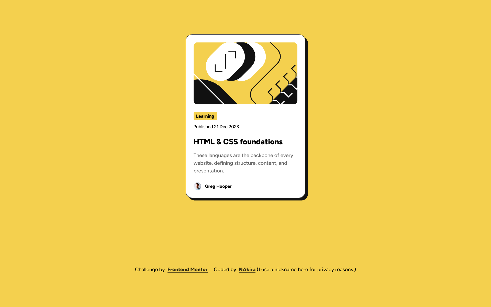

## Table of contents

- [Overview](#overview)
  - [The challenge](#the-challenge)
  - [Screenshot](#screenshot)
  - [Links](#links)
  - [Built with](#built-with)
  - [Useful resources](#useful-resources)
- [Author](#author)

## Overview

A blog preview card built with HTML & CSS

### Screenshot

### Links

- Solution URL: [Add solution URL here](https://your-solution-url.com)
- Live Site URL: [Add live site URL here](https://your-live-site-url.com)

### Built with

- Semantic HTML5 markup
- CSS custom properties
- Flexbox
- CSS Grid
- Desktop-first workflow

### Useful resources

! [Tint & Shade generator](https://maketintsandshades.com/) - This helped me to generate a shade for my links inside footer, Will definitely use this going forward.

! [Coolors](https://coolors.co/) - This helped me to check the color contrasts in my webpage for accessibility, Very important for people with reduced vision.

## Author

- Frontend Mentor - [@nakirabloody37](https://www.frontendmentor.io/profile/nakirabloody37)
